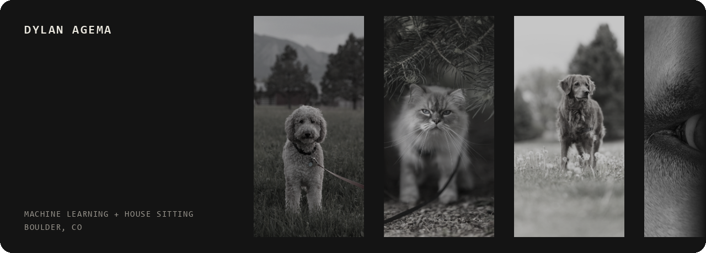
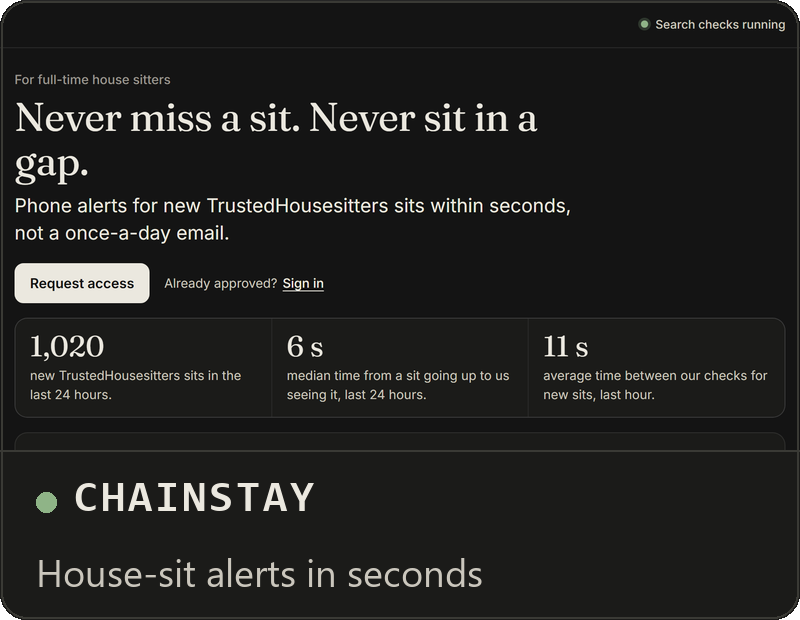
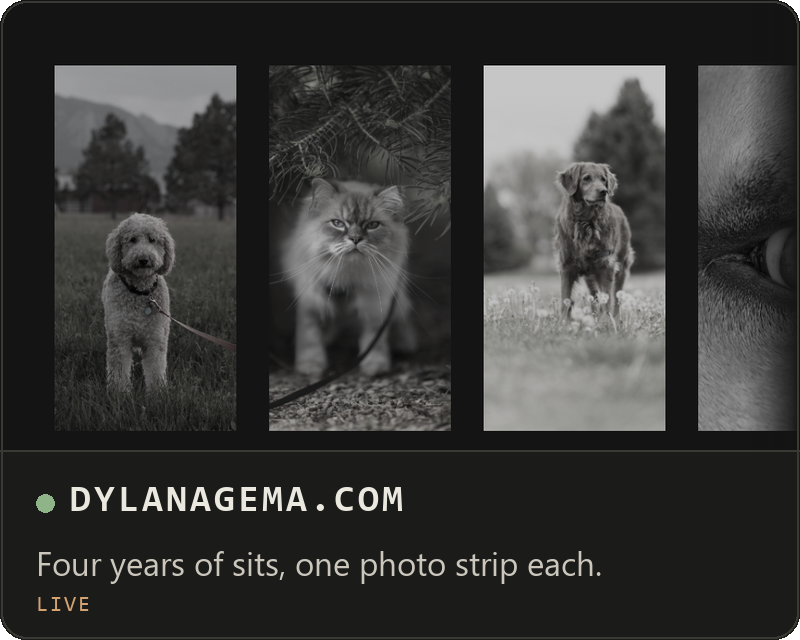
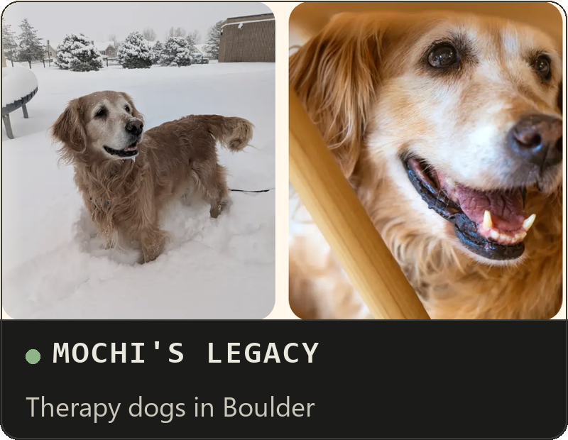
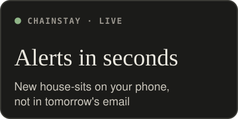
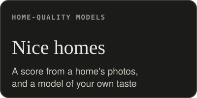
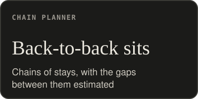
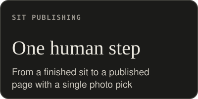
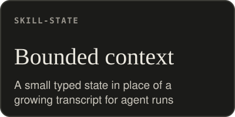
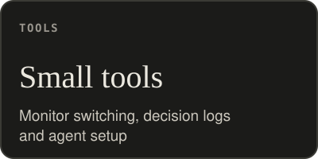

  <samp>
    <a href="https://www.dylanagema.com">site</a> ·
    <a href="https://www.dylanagema.com/chainstay/">chainstay</a> ·
    <a href="https://www.linkedin.com/in/dylan-agema/">linkedin</a>
  </samp>

Dogs, photography, ML, and living in strangers' homes.

## Running now

  
  
  

## Projects

  
  
  

  
  
  

